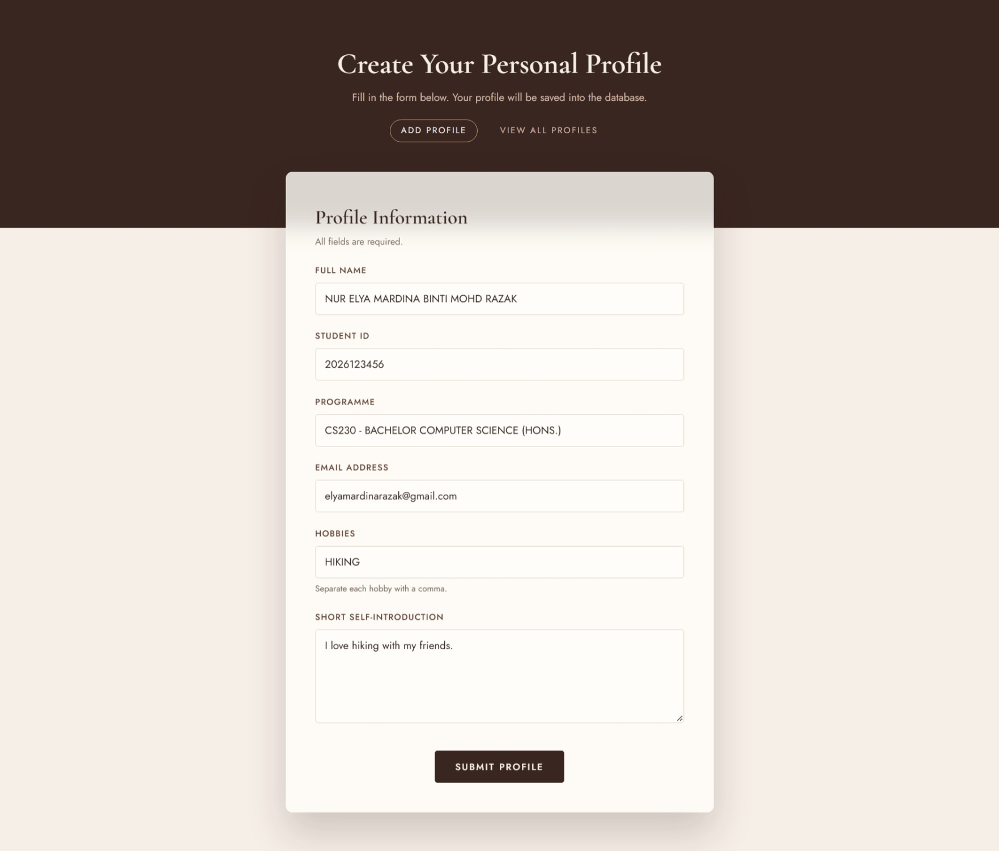
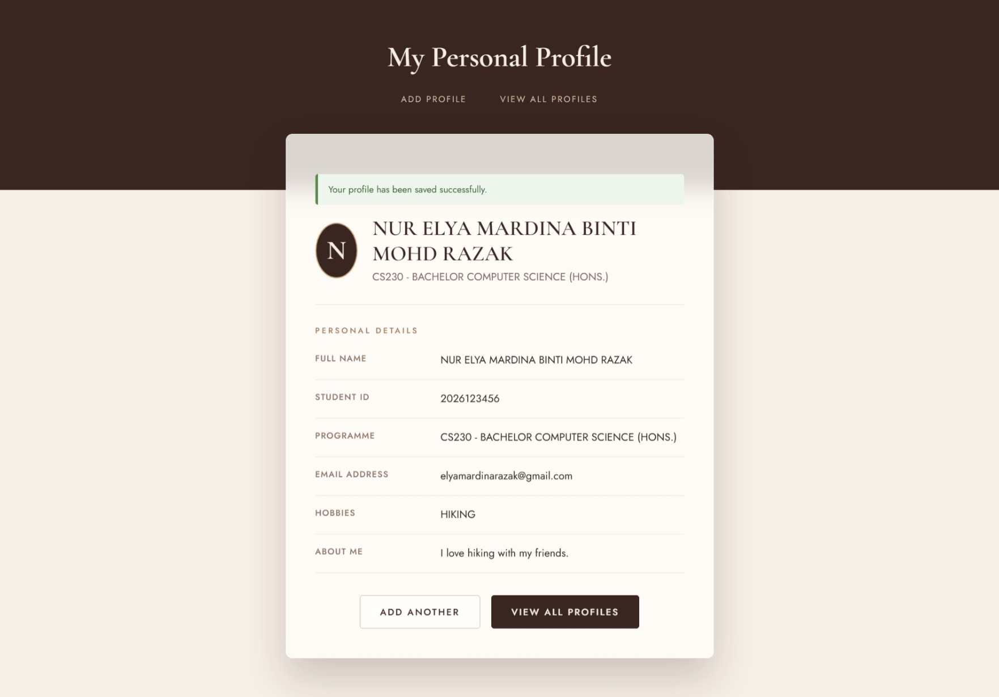
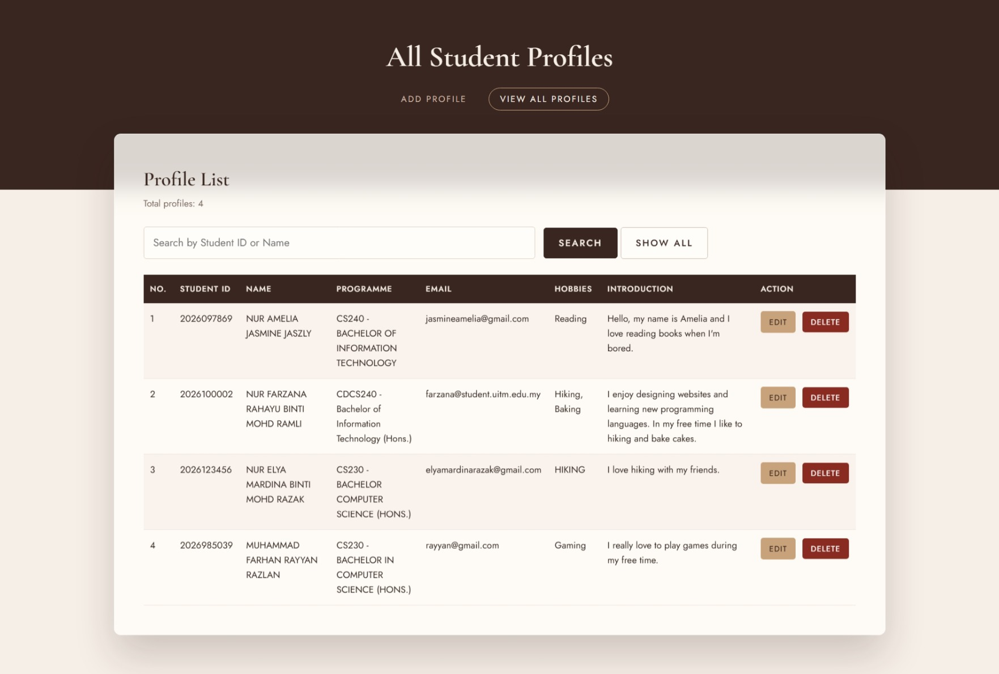
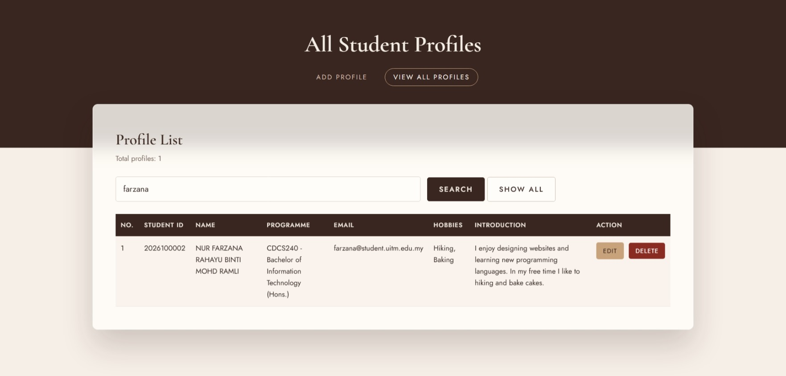
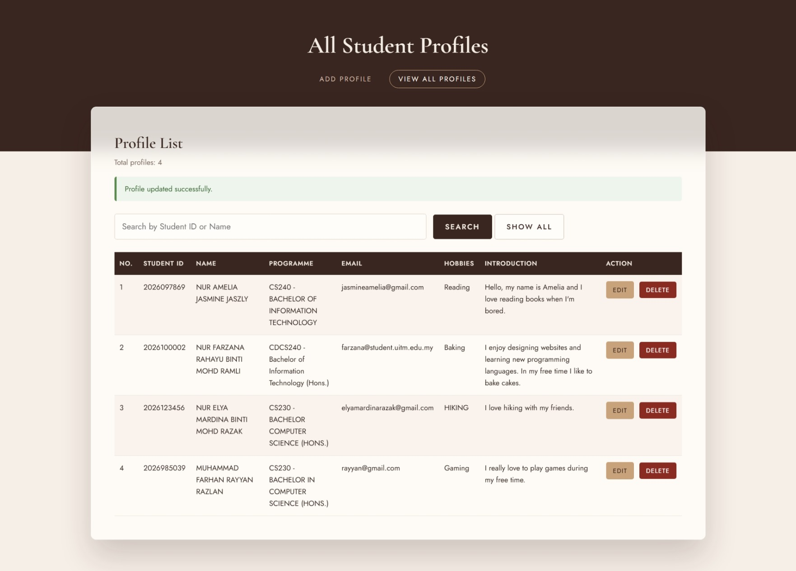
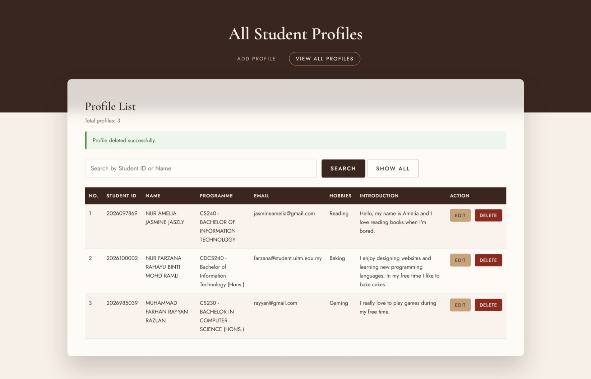

# CSC584 Individual Assignment 2 - Profile Management System

## Student Information
- Name: Nur Farzana Rahayu Binti Mohd Ramli
- Student ID: 2026130127
- Group: CS2404C

## Project Description
This project continues my Assignment 1 Profile Application. It is now a Profile Management System that saves student profiles into a database.

The user fills in the form in index.html. ProfileServlet receives the data using POST, puts it into a ProfileBean object and saves it into the StudentProfilesDB database using JDBC. The saved profile is displayed in profile.jsp, and all profiles can be viewed, searched, edited and deleted in viewProfiles.jsp.

## MVC Structure
| Component | Files |
|---|---|
| Model | `ProfileBean.java`, `ProfileDAO.java` (JDBC code) |
| View | `index.html`, `profile.jsp`, `viewProfiles.jsp`, `editProfile.jsp` |
| Controller | `ProfileServlet`, `ViewProfilesServlet`, `EditProfileServlet`, `DeleteProfileServlet` |

## Implemented Features
1. Add a new profile and save it into the database
2. Display the saved profile (profile.jsp)
3. View all profiles in a table (viewProfiles.jsp)
4. Search profile by Student ID or Name
5. Edit profile
6. Delete profile 

## Technologies Used
- HTML, CSS
- Java Servlet, JSP, JavaBean
- JDBC
- Java DB (Apache Derby)
- NetBeans IDE 8.2, GlassFish Server 4.1.1, JDK 1.8

## How to Run
1. In NetBeans, go to Services > Databases > Java DB > Create Database.
   Database Name: StudentProfilesDB, User Name: app, Password: app.
2. Connect to the database, right-click the connection > Execute Command, then run the SQL in `database.sql`.
3. Open the project in NetBeans (File > Open Project).
4. Make sure the Java DB Driver library is added (Libraries > Add Library > Java DB Driver).
5. Right-click the project > Clean and Build, then Run.
6. Open http://localhost:8080/PersonalProfile/

## Screenshots
Add Profile Form:

Profile Saved:

View All Profiles:

Search Profile:

Edit Profile:

Delete Profile:

